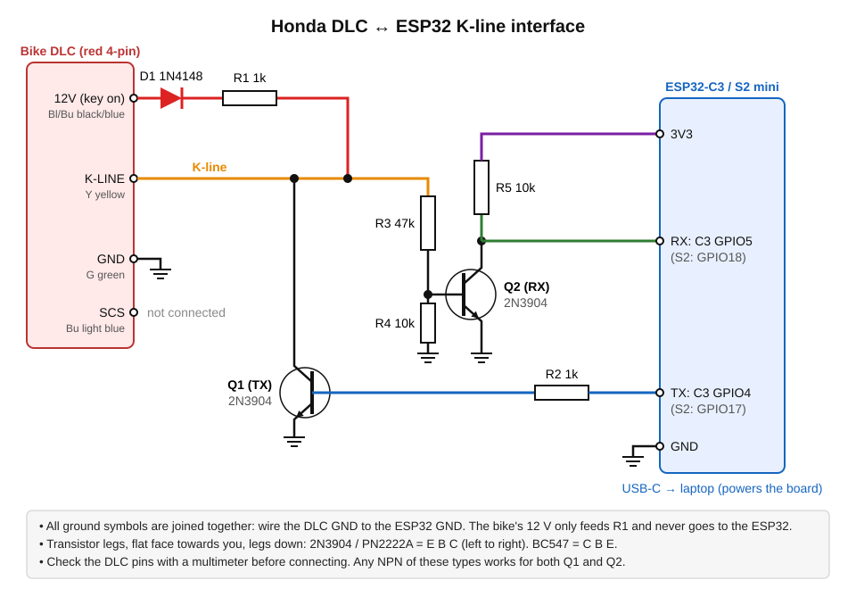

# Honda DLC Scanner (CBR250R 2011-13, MC41)

Reads live engine data and fault codes from the 4-pin red Honda DLC under the seat. It uses an ESP32-S2 mini as a
USB-to-K-line bridge and a Python app on the PC.

```
Bike DLC ──K-line── 2-transistor interface ── ESP32-S2 mini ──USB── PC (dlc_gui.py / honda_dlc.py)
```

## Parts

| Part | Notes |
|---|---|
| ESP32-S2 mini (LOLIN) | the bridge; powered from the PC's USB |
| 2 × NPN transistor | 2N3904, BC547 or 2N2222 |
| 1 × 1 kΩ | Q1 base resistor |
| 1 × 1 kΩ (½ W is fine) | K-line pull-up to 12 V |
| 1 × 47 kΩ, 1 × 10 kΩ | Q2 base divider |
| 1 × 10 kΩ | RX pull-up to 3.3 V |
| 1 × 1N4148 or 1N4007 diode | reverse protection on the 12 V feed |
| Way to plug into the DLC | a "Honda 4-pin DLC" adapter / breakout lead, or female Dupont/spade terminals pushed into the plug |
| Small stripboard/breadboard, wire, USB-C cable | |
| Multimeter | to identify the DLC pins before connecting |

Option: replace the transistors with an **L9637D** or **MC33290** K-line chip. If you do, its RX output must be
brought down to 3.3 V, and set `KLINE_INVERTED = false` in the firmware.

## Wiring



Text version:

```
DLC 12V ──|>|── 1k ──┬──────────────── DLC K-line
         1N4148      │
                     ├── C  Q1  E ── GND
   ESP GPIO17 ── 1k ─┘ B (Q1 base)
                     │
                     └── 47k ── B  Q2  E ── GND
                               B ── 10k ── GND
                               C ──┬── ESP GPIO18
                                   └── 10k ── 3V3
DLC GND ── ESP GND
```

Both stages invert, and the firmware turns on the UART's own inversion to undo it. Do **not** connect the bike's
12 V to the ESP32. Only the pull-up uses it.

**Identify the DLC pins with a multimeter first** (check the wiring diagram in the service manual for wire colours):
- GND: continuity to the frame.
- 12 V: 12 V with the key on, 0 V off.
- K-line: also about 12 V with the key on (the ECU pulls it up), but a few volts lower than the 12 V pin under load.
  Check against the diagram.
- SCS: not used here (shorting it to GND makes the dash blink stored codes).

## Firmware
Arduino IDE → install the "esp32" boards package → board **LOLIN S2 Mini**, *USB CDC On Boot: Enabled*. Open
`firmware/HondaKLine/HondaKLine.ino` and upload. (If the upload doesn't start, hold button 0, tap RST, and release.)
Check it in the Serial Monitor at 115200: typing `P` should answer `OK HONDA-KLINE 1`.

## PC app
```
pip install pyserial
python pc/dlc_gui.py
```
Choose the COM port, turn the key on (engine stop switch at RUN) and click Connect. Choose `demo` to try it
without the bike. Command-line version: `python pc/honda_dlc.py COM5 live|dump|dtc|raw <hex>`.

## Status / unverified
- The protocol (wake-up, `72 05 00 F0` init, `72 05 71 <table>` reads, checksum) is the community-documented Honda
  K-line protocol. It hasn't been run on this bike yet.
- The table 0x11 field layout and the fault-code decoding are best guesses taken from other Honda models. Use the
  raw-byte view (changed bytes light up) and "Dump tables" to confirm them. For example, blip the throttle and see
  which byte moves.
